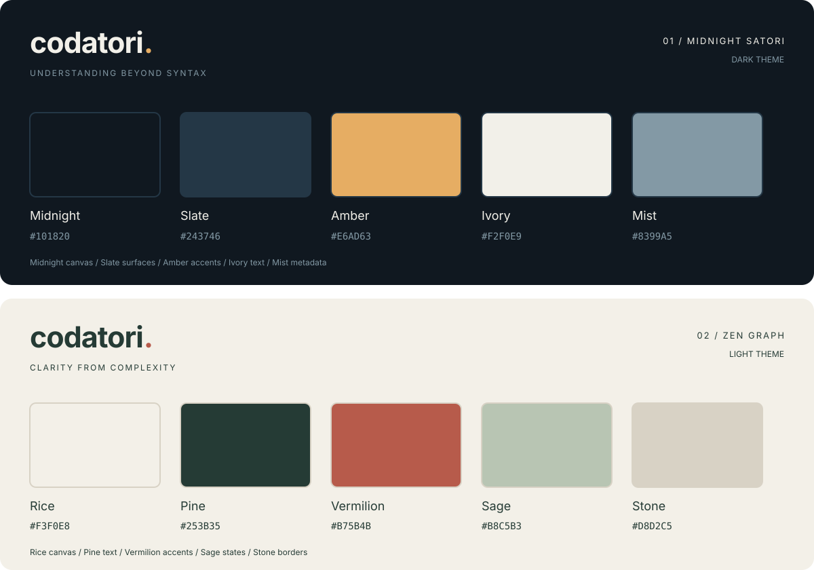

# codatori. — Color design

Two complementary themes for the codatori. system. The named palette colors
below are the canonical values; derived UI tints must reference these tokens
rather than introducing an unrelated palette.

## 1. Midnight Satori — dark theme

**Brand:** codatori.  
**Tagline:** UNDERSTANDING BEYOND SYNTAX  
**Theme identifier:** `midnight-satori`

| Color | HEX | RGB | Design role |
| --- | --- | --- | --- |
| Midnight | `#101820` | `16, 24, 32` | Page canvas, deep backgrounds, code blocks. |
| Slate | `#243746` | `36, 55, 70` | Panels, cards, and elevated surfaces. |
| Amber | `#E6AD63` | `230, 173, 99` | Brand punctuation, actions, links, selection, and focus. |
| Ivory | `#F2F0E9` | `242, 240, 233` | Primary text, headings, and high-contrast content. |
| Mist | `#8399A5` | `131, 153, 165` | Supporting metadata, graph lines, and neutral details. |

**Composition:** Midnight provides depth; Slate organizes information. Ivory
keeps the content readable, Amber identifies interaction, and Mist supports
the graph without competing with the primary content.

## 2. Zen Graph — light theme

**Brand:** codatori.  
**Tagline:** CLARITY FROM COMPLEXITY  
**Theme identifier:** `zen-graph`

| Color | HEX | RGB | Design role |
| --- | --- | --- | --- |
| Rice | `#F3F0E8` | `243, 240, 232` | Warm page canvas, cards, and primary surfaces. |
| Pine | `#253B35` | `37, 59, 53` | Primary text, headings, main buttons, and code blocks. |
| Vermilion | `#B75B4B` | `183, 91, 75` | Brand punctuation, focus outlines, selected borders, and accents. |
| Sage | `#B8C5B3` | `184, 197, 179` | Selected and hover surface tints, graph-layer markers. |
| Stone | `#D8D2C5` | `216, 210, 197` | Structural borders, separators, and quiet details. |

**Composition:** Rice provides a calm, warm foundation. Pine carries the
information, Vermilion adds deliberate emphasis, Sage softens interaction
states, and Stone separates regions without harsh outlines.

## Semantic color system

Components use semantic CSS properties defined in [themes.css](themes.css).
The same layout and interaction states apply to both themes.

| Token | Zen Graph | Midnight Satori |
| --- | --- | --- |
| `--bg` | Rice | Midnight |
| `--paper` | Rice | Slate |
| `--ink` | Pine | Ivory |
| `--brand-accent` | Vermilion | Amber |
| `--muted` | 78% Pine + 22% Rice | 70% Mist + 30% Ivory |
| `--green` (existing link/action token) | 75% Vermilion + 25% Pine | Amber |
| `--line` | Stone | 28% Mist + 72% Slate |
| `--surface-selected` | 28% Sage + 72% Rice | 12% Amber + 88% Slate |
| `--action-bg` / `--action-ink` | Pine / Rice | Amber / Midnight |
| `--code-bg` / `--code-ink` | Pine / Rice | Midnight / Ivory |
| `--edge` | 72% Pine + 28% Stone | Mist |
| `--edge-extension` | Vermilion | Amber |

Tints, borders, muted text, shadows, and selected surfaces use CSS `color-mix()`
in sRGB. The ten canonical HEX values remain unchanged. Shadow alpha is derived
from the active theme, not from an independent black or green palette.

Graph-layer markers reuse each theme's palette. Layer names and numbers remain
visible, and extension edges remain dashed: meaning must not depend on color
alone. Hovering or selecting a record must not reduce the readability of its
name or explanation.

## Readability and contrast

These are WCAG relative-luminance contrast ratios for solid colors, rounded
to two decimal places. Normal text should have at least **4.5:1** contrast;
large text and meaningful non-text graphics should have at least **3:1**.

| Foreground / background | Contrast | Guidance |
| --- | --- | --- |
| Ivory / Midnight | 15.69:1 | Primary dark-theme text. |
| Ivory / Slate | 10.77:1 | Text on dark-theme panels. |
| Amber / Midnight | 8.97:1 | Dark-theme accent text and button combination. |
| Pine / Rice | 10.50:1 | Primary light-theme text and button combination. |
| Pine / Sage | 6.65:1 | Text on Sage surfaces. |
| Vermilion / Rice | 4.00:1 | Accent graphics, focus, or large text; not small body text. |
| Mist / Slate | 4.13:1 | Graph lines or large text; lighten it for small metadata. |

For smaller text, the UI uses the documented blends: the light-theme accent
text blend is approximately **5.17:1** on Rice; muted text is approximately
**5.59:1** on Rice and **5.69:1** on Slate. Primary light-theme buttons use
Pine with Rice text instead of placing small Rice text on pure Vermilion.

## Brand and interaction rules

- Write the wordmark as **codatori.**, lowercase, including the final period.
  The period takes the active theme's accent color.
- Use the theme's exact tagline; do not exchange the light and dark taglines.
- Keep a visible keyboard focus outline. Selected cards combine surface,
  border, and explicit state changes rather than color alone.
- Preserve readable source code, JSON, attribute tables, and relation labels
  in both themes. Native form controls use the appropriate `color-scheme`.
- Zen Graph is the default. The header's theme selector applies either theme
  immediately and saves the choice in `localStorage` under `codatori.theme`
  when the browser permits it. Storage failures are reported visibly.

## Saved design assets

| File | Purpose |
| --- | --- |
| `color-design.md` | Human-readable palette and semantic design specification. |
| `color-design.svg` | Scalable, editable visual color board with both palettes. |
| `themes.css` | Canonical palette tokens, semantic mappings, and theme controls. |
| `theme.js` | Theme selection, exact brand taglines, and preference persistence. |
